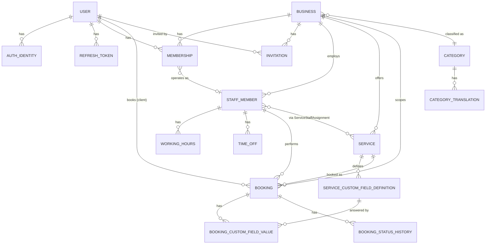
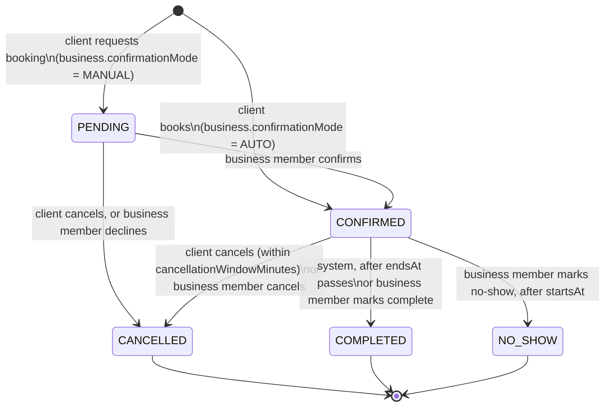

# Core domain data model

Shared domain model for M1–M6. See ADR-0009 for the key decisions behind it. Prisma schema code and
migrations are out of scope here (implemented incrementally per M1–M3 task); this document is the
contract agents align their Prisma models to.

## Conventions

- **IDs:** every table has a `String` primary key holding a UUID v7, generated application-side
  (`docs/conventions/api.md`). Never `gen_random_uuid()` (v4).
- **Naming:** Prisma models are `PascalCase` singular (`StaffMember`); table names are `snake_case`
  plural via `@@map` (`staff_members`); fields are `camelCase` in Prisma / TypeScript and map to
  `snake_case` columns via `@map`.
- **Timestamps:** every table has `createdAt DateTime @default(now())` and `updatedAt DateTime
@updatedAt`, stored as `timestamptz` (UTC). Business-facing instants (bookings, time off) are also
  `timestamptz`; working hours store local wall-clock time (see "Time").
- **Money:** integer minor units + ISO 4217 currency code, e.g. `priceAmount Int`, `priceCurrency
String @db.Char(3)`. Never floating point.
- **Soft delete:** see "Soft-delete policy" below.
- **Tenant scoping:** see "Tenant scoping" below.

## Entities

### User

| Field               | Type             | Null? | Notes                                               |
| ------------------- | ---------------- | ----- | --------------------------------------------------- |
| id                  | String (uuid v7) | no    | PK                                                  |
| email               | String           | no    | unique, lowercased/normalized                       |
| emailVerifiedAt     | DateTime         | yes   |                                                     |
| displayName         | String           | yes   |                                                     |
| avatarUrl           | String           | yes   |                                                     |
| localePreference    | String           | no    | one of `en`/`me`/`ru`/`tr`, default `en` (ADR-0004) |
| isPlatformAdmin     | Boolean          | no    | default `false`; platform admin capability          |
| createdAt/updatedAt | DateTime         | no    |                                                     |
| deletedAt           | DateTime         | yes   | soft delete                                         |

Relations: has many `AuthIdentity`, `RefreshToken`, `Membership`, `Booking` (as client), `Review`.

### AuthIdentity

One row per login method (ADR-0002: password, Google, Apple).

| Field               | Type              | Null? | Notes                                    |
| ------------------- | ----------------- | ----- | ---------------------------------------- |
| id                  | String (uuid v7)  | no    | PK                                       |
| userId              | String            | no    | FK → User                                |
| provider            | enum AuthProvider | no    | `PASSWORD`, `GOOGLE`, `APPLE`            |
| providerAccountId   | String            | yes   | external subject id; null for `PASSWORD` |
| passwordHash        | String            | yes   | argon2id; only set for `PASSWORD`        |
| createdAt/updatedAt | DateTime          | no    |                                          |

Constraints: unique `(userId, provider)`; unique `(provider, providerAccountId)` where
`providerAccountId is not null`.

### RefreshToken

| Field             | Type             | Null? | Notes                          |
| ----------------- | ---------------- | ----- | ------------------------------ |
| id                | String (uuid v7) | no    | PK                             |
| userId            | String           | no    | FK → User                      |
| tokenHash         | String           | no    | unique; raw token never stored |
| issuedAt          | DateTime         | no    |                                |
| expiresAt         | DateTime         | no    |                                |
| revokedAt         | DateTime         | yes   |                                |
| replacedByTokenId | String           | yes   | rotation chain                 |
| userAgent         | String           | yes   |                                |
| ipAddress         | String           | yes   |                                |
| createdAt         | DateTime         | no    |                                |

### Business

| Field                     | Type                  | Null? | Notes                                                        |
| ------------------------- | --------------------- | ----- | ------------------------------------------------------------ |
| id                        | String (uuid v7)      | no    | PK                                                           |
| name                      | String                | no    |                                                              |
| slug                      | String                | no    | unique; public URL                                           |
| categoryId                | String                | no    | FK → Category                                                |
| description               | String                | yes   |                                                              |
| timezone                  | String                | no    | IANA tz name, default `Europe/Podgorica` (ADR-0005)          |
| city                      | String                | yes   |                                                              |
| address                   | String                | yes   |                                                              |
| contactPhone              | String                | yes   |                                                              |
| contactEmail              | String                | yes   |                                                              |
| confirmationMode          | enum ConfirmationMode | no    | `AUTO` \| `MANUAL`, default `AUTO` (open question Q3)        |
| cancellationWindowMinutes | Int                   | no    | default `120` (open question Q4)                             |
| status                    | enum BusinessStatus   | no    | `PENDING_APPROVAL`, `APPROVED`, `REJECTED`, `SUSPENDED` (Q8) |
| approvedAt                | DateTime              | yes   |                                                              |
| createdAt/updatedAt       | DateTime              | no    |                                                              |
| deletedAt                 | DateTime              | yes   | soft delete                                                  |

Relations: has many `Membership`, `Invitation`, `StaffMember`, `Service`, `Booking`, `Review`.

### Membership

A user's role inside a business (glossary: OWNER / ADMIN / STAFF).

| Field               | Type                | Null? | Notes                                                                            |
| ------------------- | ------------------- | ----- | -------------------------------------------------------------------------------- |
| id                  | String (uuid v7)    | no    | PK                                                                               |
| userId              | String              | no    | FK → User                                                                        |
| businessId          | String              | no    | FK → Business                                                                    |
| role                | enum MembershipRole | no    | `OWNER`, `ADMIN`, `STAFF`                                                        |
| staffMemberId       | String              | yes   | FK → StaffMember (unique); the bookable resource this member operates as, if any |
| createdAt/updatedAt | DateTime            | no    |                                                                                  |

Constraints: unique `(userId, businessId)`.

### Invitation

| Field               | Type                  | Null? | Notes                                       |
| ------------------- | --------------------- | ----- | ------------------------------------------- |
| id                  | String (uuid v7)      | no    | PK                                          |
| businessId          | String                | no    | FK → Business                               |
| email               | String                | no    | invitee, need not have an account yet       |
| role                | enum MembershipRole   | no    |                                             |
| staffMemberId       | String                | yes   | FK → StaffMember, pre-links the invite      |
| invitedByUserId     | String                | no    | FK → User                                   |
| tokenHash           | String                | no    | unique                                      |
| status              | enum InvitationStatus | no    | `PENDING`, `ACCEPTED`, `EXPIRED`, `REVOKED` |
| expiresAt           | DateTime              | no    |                                             |
| acceptedAt          | DateTime              | yes   |                                             |
| createdAt/updatedAt | DateTime              | no    |                                             |

### StaffMember

The bookable resource (glossary). May exist without a linked `Membership`/user account.

| Field               | Type             | Null? | Notes                                                       |
| ------------------- | ---------------- | ----- | ----------------------------------------------------------- |
| id                  | String (uuid v7) | no    | PK                                                          |
| businessId          | String           | no    | FK → Business                                               |
| displayName         | String           | no    |                                                             |
| photoUrl            | String           | yes   |                                                             |
| active              | Boolean          | no    | default `true`; hides from booking without deleting history |
| createdAt/updatedAt | DateTime         | no    |                                                             |
| deletedAt           | DateTime         | yes   | soft delete                                                 |

Relations: has many `WorkingHours`, `TimeOff`, `Booking`; many-to-many with `Service` via
`ServiceStaffAssignment`; optionally referenced by one `Membership`.

### Service

| Field               | Type             | Null? | Notes                                     |
| ------------------- | ---------------- | ----- | ----------------------------------------- |
| id                  | String (uuid v7) | no    | PK                                        |
| businessId          | String           | no    | FK → Business                             |
| name                | String           | no    | business-entered, single language (Q7)    |
| description         | String           | yes   |                                           |
| durationMinutes     | Int              | no    | > 0                                       |
| bufferBeforeMinutes | Int              | no    | default `0`; blocked time before the slot |
| bufferAfterMinutes  | Int              | no    | default `0`; blocked time after the slot  |
| priceAmount         | Int              | no    | minor units                               |
| priceCurrency       | String           | no    | ISO 4217, e.g. `EUR`                      |
| active              | Boolean          | no    | default `true`                            |
| createdAt/updatedAt | DateTime         | no    |                                           |
| deletedAt           | DateTime         | yes   | soft delete                               |

Relations: many-to-many with `StaffMember` via `ServiceStaffAssignment`; has many
`ServiceCustomFieldDefinition`, `Booking`.

### ServiceStaffAssignment

Join table: which staff members can perform a service.

| Field         | Type             | Null? | Notes            |
| ------------- | ---------------- | ----- | ---------------- |
| id            | String (uuid v7) | no    | PK               |
| serviceId     | String           | no    | FK → Service     |
| staffMemberId | String           | no    | FK → StaffMember |
| createdAt     | DateTime         | no    |                  |

Constraints: unique `(serviceId, staffMemberId)`.

### ServiceCustomFieldDefinition

Generic custom booking fields per service (open question Q2 default: generic, not
transfer-specific).

| Field               | Type                 | Null? | Notes                                                 |
| ------------------- | -------------------- | ----- | ----------------------------------------------------- |
| id                  | String (uuid v7)     | no    | PK                                                    |
| serviceId           | String               | no    | FK → Service                                          |
| key                 | String               | no    | stable identifier, e.g. `pickup_address`              |
| label               | String               | no    | business-entered, single language (Q7)                |
| type                | enum CustomFieldType | no    | `TEXT`, `NUMBER`, `SELECT`                            |
| required            | Boolean              | no    | default `false`                                       |
| options             | Json                 | yes   | `SELECT` only: `[{ "value": "...", "label": "..." }]` |
| sortOrder           | Int                  | no    | default `0`                                           |
| createdAt/updatedAt | DateTime             | no    |                                                       |

Constraints: unique `(serviceId, key)`.

### WorkingHours

Weekly recurring availability of a staff member, local wall-clock time (ADR-0005). Several rows per
weekday are allowed (e.g. split shifts).

| Field               | Type                   | Null? | Notes                                            |
| ------------------- | ---------------------- | ----- | ------------------------------------------------ |
| id                  | String (uuid v7)       | no    | PK                                               |
| staffMemberId       | String                 | no    | FK → StaffMember                                 |
| weekday             | enum Weekday           | no    | `MONDAY` … `SUNDAY`                              |
| startTime           | DateTime `@db.Time(0)` | no    | local wall-clock time, business timezone         |
| endTime             | DateTime `@db.Time(0)` | no    | local wall-clock time; must be after `startTime` |
| createdAt/updatedAt | DateTime               | no    |                                                  |

### TimeOff

One-off unavailability (vacation, sick day, break). Stored as an absolute UTC range.

| Field               | Type             | Null? | Notes                           |
| ------------------- | ---------------- | ----- | ------------------------------- |
| id                  | String (uuid v7) | no    | PK                              |
| staffMemberId       | String           | no    | FK → StaffMember                |
| startsAt            | DateTime         | no    | `timestamptz`                   |
| endsAt              | DateTime         | no    | `timestamptz`, after `startsAt` |
| reason              | String           | yes   |                                 |
| createdAt/updatedAt | DateTime         | no    |                                 |

### Booking

The reservation of a staff member for a service at a time range (glossary).

| Field               | Type               | Null? | Notes                                                             |
| ------------------- | ------------------ | ----- | ----------------------------------------------------------------- |
| id                  | String (uuid v7)   | no    | PK                                                                |
| businessId          | String             | no    | FK → Business; denormalized for tenant scoping and indexes        |
| serviceId           | String             | no    | FK → Service                                                      |
| staffMemberId       | String             | no    | FK → StaffMember                                                  |
| clientUserId        | String             | no    | FK → User; account required to book (open question Q6 default)    |
| createdByUserId     | String             | no    | FK → User; client, or business member for walk-ins/manual entries |
| startsAt            | DateTime           | no    | `timestamptz`, UTC                                                |
| endsAt              | DateTime           | no    | `timestamptz`, UTC, after `startsAt`                              |
| bufferBeforeMinutes | Int                | no    | snapshot of `Service.bufferBeforeMinutes` at booking time         |
| bufferAfterMinutes  | Int                | no    | snapshot of `Service.bufferAfterMinutes` at booking time          |
| status              | enum BookingStatus | no    | `PENDING`, `CONFIRMED`, `CANCELLED`, `COMPLETED`, `NO_SHOW`       |
| priceAmount         | Int                | no    | snapshot of `Service.priceAmount` at booking time                 |
| priceCurrency       | String             | no    | snapshot of `Service.priceCurrency`                               |
| cancelledAt         | DateTime           | yes   |                                                                   |
| cancelledByUserId   | String             | yes   | FK → User                                                         |
| cancellationReason  | String             | yes   |                                                                   |
| notes               | String             | yes   | business-internal note                                            |
| createdAt/updatedAt | DateTime           | no    |                                                                   |

Price and buffers are **snapshotted** on the booking row so later edits to the service do not change
historical bookings or the already-computed blocked range.

Not modeled as a Prisma column (raw SQL only, see "Integrity rules"): a generated
`blocked_range tstzrange` column derived from `starts_at`, `ends_at` and the buffer snapshots, used by
the exclusion constraint.

Relations: has many `BookingCustomFieldValue`, `BookingStatusHistory`; optionally one `Review`.

### BookingCustomFieldValue

| Field             | Type             | Null? | Notes                                         |
| ----------------- | ---------------- | ----- | --------------------------------------------- |
| id                | String (uuid v7) | no    | PK                                            |
| bookingId         | String           | no    | FK → Booking                                  |
| fieldDefinitionId | String           | no    | FK → ServiceCustomFieldDefinition             |
| value             | Json             | no    | typed per `ServiceCustomFieldDefinition.type` |
| createdAt         | DateTime         | no    |                                               |

Constraints: unique `(bookingId, fieldDefinitionId)`.

### BookingStatusHistory

Append-only audit trail of every status transition (see state machine below).

| Field           | Type               | Null? | Notes                                                         |
| --------------- | ------------------ | ----- | ------------------------------------------------------------- |
| id              | String (uuid v7)   | no    | PK                                                            |
| bookingId       | String             | no    | FK → Booking                                                  |
| fromStatus      | enum BookingStatus | yes   | null for the initial row                                      |
| toStatus        | enum BookingStatus | no    |                                                               |
| changedByUserId | String             | yes   | FK → User; null when `changedBySystem`                        |
| changedBySystem | Boolean            | no    | default `false` (e.g. reminder job auto-completing a booking) |
| reason          | String             | yes   |                                                               |
| createdAt       | DateTime           | no    |                                                               |

### Category

Platform-managed classification (glossary), with translations.

| Field               | Type             | Null? | Notes              |
| ------------------- | ---------------- | ----- | ------------------ |
| id                  | String (uuid v7) | no    | PK                 |
| slug                | String           | no    | unique, stable key |
| iconKey             | String           | yes   |                    |
| sortOrder           | Int              | no    | default `0`        |
| createdAt/updatedAt | DateTime         | no    |                    |

### CategoryTranslation

| Field      | Type             | Null? | Notes                                 |
| ---------- | ---------------- | ----- | ------------------------------------- |
| id         | String (uuid v7) | no    | PK                                    |
| categoryId | String           | no    | FK → Category                         |
| locale     | String           | no    | one of `en`/`me`/`ru`/`tr` (ADR-0004) |
| name       | String           | no    |                                       |

Constraints: unique `(categoryId, locale)`.

## Placeholders (designed in their own M4–M6 tasks)

Noted so later schema work fits the model; fields are illustrative, not final.

- **Review** — `id`, `bookingId` (unique, one review per completed booking), `businessId`,
  `clientUserId`, `rating`, `comment`, moderation state, `createdAt`/`updatedAt`.
- **Device / PushToken** — `id`, `userId`, `expoPushToken`, `platform`, `lastSeenAt`.
- **NotificationPreference** — `id`, `userId`, `channel`, `category`, `enabled`.
- **TelegramLink** — `id`, `userId`, `telegramChatId`, `linkedAt`.

## Entity-relationship diagram



## Booking status state machine



Notes:

- Only `PENDING` and `CONFIRMED` are "active" for the overlap exclusion constraint; `CANCELLED`,
  `COMPLETED` and `NO_SHOW` never block a slot.
- **Reschedule** (vision: clients and businesses can reschedule) is modeled as updating `startsAt` /
  `endsAt` on the same `Booking` row while it is `PENDING` or `CONFIRMED`, re-validated against the
  exclusion constraint like a new booking; it does not change `status` and is recorded as its own
  audit event (a `BookingStatusHistory` row with `fromStatus == toStatus` plus a reason, or a future
  `BookingReschedule` log if more detail is needed — out of scope here).
- Every transition writes a `BookingStatusHistory` row; `changedBySystem = true` marks automatic
  transitions (e.g. the completion job).
- "System" transitions run as scheduled jobs (ADR-0006) that re-check the current status before
  acting, so a `CANCELLED` booking is never marked `COMPLETED`.

## Integrity rules

### Overlap exclusion constraint (ADR-0005)

Prisma cannot express exclusion constraints, so this constraint is raw SQL in a migration (the
`btree_gist` extension is already enabled by the baseline migration
`apps/api/prisma/migrations/20260928184345_init`).

Buffers extend the range a booking blocks. Rather than computing this in application code (which
would race with the exclusion check), the range is a generated, stored column derived from the
buffer snapshot on the row:

```sql
ALTER TABLE bookings
  ADD COLUMN blocked_range tstzrange GENERATED ALWAYS AS (
    tstzrange(
      starts_at - (buffer_before_minutes || ' minutes')::interval,
      ends_at + (buffer_after_minutes || ' minutes')::interval,
      '[)'
    )
  ) STORED;

ALTER TABLE bookings
  ADD CONSTRAINT bookings_no_overlap
  EXCLUDE USING gist (
    staff_member_id WITH =,
    blocked_range WITH &&
  )
  WHERE (status IN ('PENDING', 'CONFIRMED'));
```

The API maps a violation (Postgres error `23P01`) to `409 SLOT_TAKEN` (`docs/conventions/api.md`).

### Other unique constraints

- `users.email` unique.
- `auth_identities` unique `(user_id, provider)`; unique `(provider, provider_account_id)` where
  `provider_account_id IS NOT NULL`.
- `refresh_tokens.token_hash` unique.
- `memberships` unique `(user_id, business_id)`.
- `staff_members` unique `membership_id` (nullable, so at most one staff record per membership).
- `invitations.token_hash` unique.
- `businesses.slug` unique.
- `service_staff_assignments` unique `(service_id, staff_member_id)`.
- `service_custom_field_definitions` unique `(service_id, key)`.
- `booking_custom_field_values` unique `(booking_id, field_definition_id)`.
- `categories.slug` unique.
- `category_translations` unique `(category_id, locale)`.

### Required indexes

- `bookings (staff_member_id, starts_at)` — calendar and availability queries; the exclusion
  constraint's GiST index on `(staff_member_id, blocked_range)` also serves overlap lookups.
- `bookings (business_id, starts_at)` — business calendar across all staff.
- `bookings (client_user_id, starts_at)` — "my bookings".
- `working_hours (staff_member_id, weekday)`.
- `time_off (staff_member_id, starts_at, ends_at)`.
- `services (business_id)`, `staff_members (business_id)`, `memberships (business_id)`,
  `invitations (business_id)` — tenant-scoped listing.
- `businesses (status, category_id, city)` — marketplace search/discovery.
- `refresh_tokens (user_id)`.

### Tenant scoping

Every table owned by a business carries a path back to `businessId`: directly (`Business`,
`Membership`, `Invitation`, `StaffMember`, `Service`, `Booking` — denormalized onto `Booking` for
simpler queries and indexes even though it is derivable via `serviceId`/`staffMemberId`), or
transitively through `StaffMember`/`Service` (`WorkingHours`, `TimeOff`,
`ServiceCustomFieldDefinition`, `ServiceStaffAssignment`). Every business-scoped API endpoint filters
by `businessId` and verifies the caller's `Membership` and role in that business
(`docs/conventions/api.md`); this is enforced in services, not only at the query level.

### Soft-delete policy

- Soft-deleted (`deletedAt` timestamp) so booking history and audit trails remain valid after
  removal: `User`, `Business`, `StaffMember`, `Service`.
- `active` boolean (not deletion) temporarily hides a `StaffMember` or `Service` from booking without
  losing history; soft delete is for permanent removal.
- Everything else is hard-deleted or naturally append-only (`RefreshToken`, `Invitation`,
  `WorkingHours`, `TimeOff`, `BookingStatusHistory`, `BookingCustomFieldValue`). `Booking` rows are
  never deleted, only transitioned to `CANCELLED`.
- Default Prisma queries exclude soft-deleted rows (e.g. a repository-layer `deletedAt: null` filter
  or a Prisma Client extension); this is an implementation detail for the M1–M3 tasks that add these
  models.

### Money and time representations

- Money: integer minor units + ISO 4217 currency code, matching `docs/conventions/api.md`. Snapshotted
  onto `Booking` at creation time so later price changes do not alter historical bookings.
- Time: all instants (`Booking.startsAt/endsAt`, `TimeOff.startsAt/endsAt`, all `createdAt/updatedAt`)
  are `timestamptz` in UTC. `WorkingHours.startTime/endTime` are local wall-clock times (no date, no
  timezone) interpreted in `Business.timezone` at slot-computation time, so a fixed 09:00–17:00 shift
  stays 09:00–17:00 local across DST transitions (ADR-0005). Slot computation must therefore reproject
  working hours into UTC per-day, not store a UTC offset once.

## Open questions this model assumes an answer for

See `docs/product/open-questions.md` for Q2, Q3, Q4, Q6 and Q8 — this model uses each question's
listed default. Confirm them with the user before the M2/M3 tasks that depend on them, in case the
default should change.
